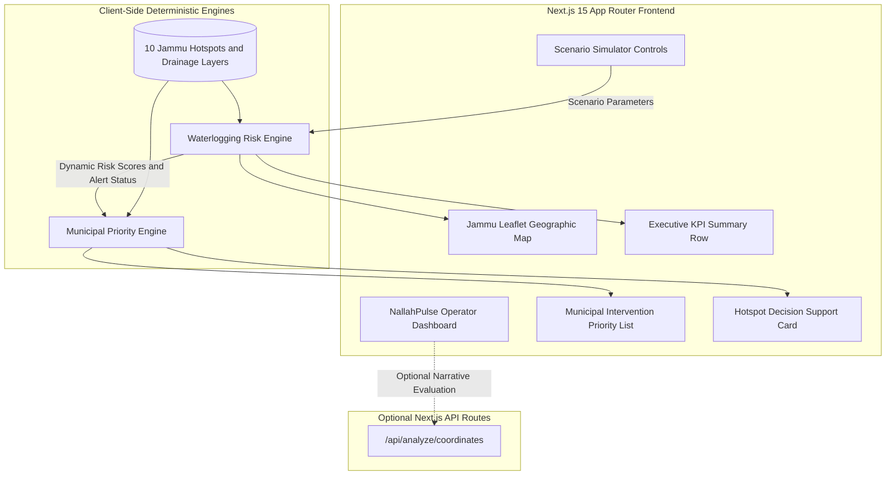

# NallahPulse

## Jammu Urban Waterlogging Intelligence

> **Civic-Tech Decision-Support Prototype**
> Developed for **Hack for a Social Cause (HSC) 2027** under the **Viksit Bharat Young Leaders Dialogue (VBYLD) 2027**.

---

## Table of Contents

- [Overview](#overview)
- [Problem Context](#problem-context)
- [Solution](#solution)
- [How It Works](#how-it-works)
- [Architecture](#architecture)
- [Technology Stack](#technology-stack)
- [Project Structure](#project-structure)
- [Installation & Setup](#installation--setup)
- [Environment Variables](#environment-variables)
- [Prototype Risk Methodology](#prototype-risk-methodology)
- [Municipal Priority Methodology](#municipal-priority-methodology)
- [Scenario Controls & Demonstration Presets](#scenario-controls--demonstration-presets)
- [Prototype Demonstration Dataset](#prototype-demonstration-dataset)
- [Limitations](#limitations)
- [Future Scope](#future-scope)
- [AI Usage Disclosure](#ai-usage-disclosure)

---

## Overview

**NallahPulse** is an open-source civic-technology decision-support prototype engineered for the city of Jammu, Jammu & Kashmir. It demonstrates how localized urban topography, natural stormwater drainage channels (*nallahs*), and interactive environmental scenarios can be modeled together to anticipate urban waterlogging vulnerability and dynamically prioritize municipal interventions.

During intense monsoon storms and localized cloudburst events, urban corridors in Jammu, such as low-lying basins along Canal Road, Krishna Nagar, Muthi, and Jewel Chowk, experience severe stormwater stagnation, culvert intake choking, and drainage overflows. NallahPulse provides city engineers, ward officers, and municipal operators with an intuitive, real-time scenario simulator that translates meteorological and drainage conditions into actionable risk scores and prioritized operational actions.

The platform is designed around transparent, deterministic mathematical indexing rather than opaque "black-box" models. By giving operators direct control over rainfall intensity, storm duration, antecedent soil moisture, season baselines, and drainage blockage states, NallahPulse serves as an exploratory decision-support interface for municipal emergency preparedness and infrastructure maintenance planning.

---

## Problem Context

Urban waterlogging in Jammu is characterized by a combination of steep topography shedding runoff rapidly into low-elevation alluvial basins, expanding impervious surface area, and severe solid-waste or silt blockage in natural *nallah* conduits (such as Landoi Choi Nallah and the Muthi/Canal drainage network).

Key operational challenges faced during extreme weather include:

1. **Lack of Localized Granularity:** General city weather forecasts fail to pinpoint which specific intersections or ward low-points will inundate first.
2. **Delayed Intervention Triage:** Municipal emergency assets (portable dewatering pumps, mechanical desilting excavators, traffic diversion units) are often deployed reactively rather than pre-positioned based on compound risk factors.
3. **Blockage Sensitivity:** Even moderate rainfall causes severe localized inundation if culvert intake screens are choked with silt or debris.

---

## Solution

NallahPulse addresses these challenges through a unified decision-support dashboard featuring:

1. **Jammu-Centered Interactive Map:** An interactive Leaflet map rendering 10 monitored prototype hotspot nodes across Jammu Municipal Corporation (JMC) wards, alongside illustrative natural drainage corridor alignments.
2. **Interactive Scenario Simulator:** Instant operator controls for rainfall intensity (0–120 mm/h), duration (0.5–12 hrs), soil moisture saturation (0–100%), seasonal baseline conditions, and drainage blockage overrides.
3. **Deterministic Waterlogging Risk Engine:** A multi-factor mathematical model computing dynamic risk scores (0–100) and risk tiers (`LOW`, `MODERATE`, `HIGH`, `CRITICAL`).
4. **City Alert Tier Aggregator:** Automatic city-wide alert level synthesis (`GREEN`, `YELLOW`, `ORANGE`, `RED`) with live field deployment guidance.
5. **Municipal Intervention Priority Engine:** A transparent triage model weighting physical risk (60%) with urban population impact (20%), channel blockage (10%), and drainage vulnerability (10%) into a 1–10 priority ranking (`LOW PRIORITY`, `MONITOR / PREPARE`, `HIGH PRIORITY`, `IMMEDIATE`).
6. **Decision Support Cards:** Contextual cards providing deterministic rationale breakdowns and actionable *"Suggested Prototype Actions"* per hotspot.

---

## How It Works

The operational decision pipeline flows deterministically from scenario input to municipal recommendation:

```text
[ Operator Scenario Parameters ]
(Rainfall Intensity, Duration, Soil Saturation, Season, Blockage, Flash Mode)
                    ↓
        [ Waterlogging Risk Engine ]
   (Evaluates 6 Local Physical & Hydraulic Factors)
                    ↓
        [ Waterlogging Risk Level ]
      (LOW • MODERATE • HIGH • CRITICAL)
                    ↓
     [ Municipal Priority Engine ]
(Weights Live Risk [60%] + Population [20%] + Blockage [10%] + Drainage [10%])
                    ↓
  [ Municipal Intervention Priority ]
 (IMMEDIATE • HIGH PRIORITY • MONITOR / PREPARE • LOW PRIORITY)
                    ↓
     [ Suggested Prototype Action ]
(Targeted Mechanical Desilting, Pump Pre-Positioning, or Routine Patrol)
```

---

## Architecture



---

## Technology Stack

- **Core Framework:** Next.js 15.4.5 (React 18.3.1, TypeScript 5)
- **Styling & UI:** Tailwind CSS, Radix UI Primitives, Lucide React Icons
- **Mapping & GIS:** Leaflet 1.9.4, React Leaflet 4.2.1
- **AI Narrative (Optional):** `@google/generative-ai` (Google Gemini Pro)
- **Build & Dev Tooling:** Turbopack, PostCSS, Autoprefixer, TSX

---

## Project Structure

```text
nallah-pulse/
├── app/
│   ├── api/
│   │   ├── analyze/
│   │   │   ├── coordinates/route.ts  # Optional coordinate AI route
│   │   │   └── image/route.ts        # Optional image AI route
│   │   └── health/route.ts           # Backend health check
│   ├── globals.css                   # Global styles & Tailwind utilities
│   ├── layout.tsx                    # Root layout with metadata
│   └── page.tsx                      # Primary NallahPulse operational dashboard
├── components/
│   ├── ClientMap.tsx                 # Leaflet map with hotspot markers & corridors
│   ├── InteractiveMap.tsx            # Dynamic SSR-safe map container wrapper
│   ├── RainfallSimulator.tsx         # Scenario controls, presets, priority table & cards
│   └── ui/                           # Reusable UI components (buttons, cards, badges, tabs)
├── docs/
│   ├── architecture.md               # Detailed system architecture specification
│   ├── testing.md                    # Comprehensive test matrices & verification logs
│   └── submission-readiness.md       # HSC 2027 / VBYLD competition checklist
├── lib/
│   ├── data/
│   │   └── jammuHotspots.ts          # 10 Jammu prototype hotspots & drainage corridors
│   ├── gemini.ts                     # Gemini client with built-in offline fallbacks
│   ├── priorityEngine.ts             # 60/20/10/10 municipal triage prioritization engine
│   ├── riskEngine.ts                 # 6-factor deterministic waterlogging risk engine
│   └── utils.ts                      # Class-name merge utility
├── scripts/
│   └── test-phase4.ts                # Programmatic scenario acceptance test suite
├── .env.example                      # Template for optional environment variables
├── LICENSE                           # MIT License with upstream attribution
└── README.md                         # Project documentation
```

---

## Installation & Setup

### Prerequisites

- **Node.js:** v18.17.0 or higher
- **npm:** v9.0.0 or higher

### Steps

1. **Clone the repository:**

```bash
   git clone https://github.com/ParthPatidar611/nallah-pulse.git
   cd nallah-pulse
```

2. **Install dependencies:**

```bash
   npm install
```

3. **Configure environment variables (optional):**

```bash
   cp .env.example .env.local
```

   > The core NallahPulse simulation and prioritization engines work 100% offline without any API keys.

4. **Run the development server:**

```bash
   npm run dev
```

   Open [http://localhost:3000](http://localhost:3000) in your browser.

5. **Build for production:**

```bash
   npm run build
   npm run start
```

---

## Environment Variables

| Variable | Required | Description |
| :--- | :---: | :--- |
| `GEMINI_API_KEY` | Optional | Google Gemini API key used only for narrative coordinate and image analysis under the "Coordinates" tab. If omitted, built-in fallback data is returned. |
| `NEXT_PUBLIC_API_BASE_URL` | Optional | Custom backend URL if hosting API routes externally (leave blank for local Next.js API routes). |

---
## Prototype Risk Methodology

The **Waterlogging Risk Engine** (`lib/riskEngine.ts`) computes a deterministic composite score (0 to 100) for each hotspot node:

```text
Risk Score = clamp(0, 100, C_rain + C_drain + C_hist + C_block + C_terr + C_moist)
```

### Factor Breakdown

**Rainfall (`C_rain`, max about 28 pts):** normalized intensity modulated by storm duration and flash event mode.

```text
C_rain = min(100, (Intensity_mm_per_h / 80) * 100 * DurationMultiplier)
         * (HotspotRainfallFactor / 100) * 0.28
```

**Drainage (`C_drain`, max about 30 pts):** base vulnerability scaled by seasonal capacity reduction and the channel blockage multiplier.

```text
C_drain = min(100, DrainageVuln / SeasonFactor) * BlockageMultiplier * 0.30
```

**Other factors:**

| Factor | Max points | Formula |
| :--- | :---: | :--- |
| Historical Vulnerability (`C_hist`) | about 20 | `HistoricalInundationProxy * 0.20` |
| Blockage Obstruction (`C_block`) | about 12 | `ChannelDebrisFactor * BlockageMultiplier * 0.12` |
| Terrain Depression (`C_terr`) | about 6 | `TopographicBasinScore * 0.06` |
| Antecedent Soil Moisture (`C_moist`) | about 12 | `SaturationLevel (with seasonal baseline boost) * 0.12` |

### Risk Categories

| Tier | Score range |
| :--- | :--- |
| **CRITICAL** | `S >= 78` |
| **HIGH** | `60 <= S < 78` |
| **MODERATE** | `38 <= S < 60` |
| **LOW** | `S < 38` |

---

## Municipal Priority Methodology

The **Municipal Intervention Priority Engine** (`lib/priorityEngine.ts`) translates physical waterlogging risk into actionable municipal triage urgency:

```text
Priority Score = clamp(0, 100,
                       RiskScore       * 0.60
                     + PopulationProxy * 0.20
                     + BlockageFactor  * 0.10
                     + DrainageVuln    * 0.10)
```

### Priority Tiers

| Tier | Score range | Recommended action |
| :--- | :--- | :--- |
| **IMMEDIATE** | `P >= 80` | High-urgency mechanical desilting, mobile pumping unit dispatch, and intersection traffic diversion |
| **HIGH PRIORITY** | `60 <= P < 80` | Standby pump staging and culvert intake monitoring |
| **MONITOR / PREPARE** | `40 <= P < 60` | Conduit debris screen inspection and inflow tracking |
| **LOW PRIORITY** | `P < 40` | Routine scheduled ward patrol and maintenance |

## Scenario Controls & Demonstration Presets

NallahPulse includes 4 instant demonstration presets:

| Preset | Rainfall | Duration | Soil moisture | Other |
| :--- | :--- | :--- | :--- | :--- |
| **Normal Monsoon** | 25 mm/h | 1 hr | 40% | Peak-Monsoon baseline |
| **Heavy Rain** | 60 mm/h (sustained) | 2 hrs | 70% | – |
| **Blockage Crisis** | 50 mm/h | 2 hrs | 60% | Blocked nallah override active |
| **Cloudburst / Flash Storm** | 85 mm/h (extreme torrent) | 1 hr | 85% | Flash storm surge mode active |

---

## Prototype Demonstration Dataset

The repository includes 10 prototype urban nodes across Jammu Municipal Corporation wards:

| Node | Context |
| :--- | :--- |
| **Krishna Nagar** | Canal Road basin |
| **Muthi** | Muthi Nallah / Canal area |
| **Jewel Chowk** | Commercial junction |
| **Dogra Chowk** | Tawi bridge roadway approach |
| **Nai Basti** | R.S. Pura Road drain convergence |
| **Talab Tillo** | Main road commercial corridor |
| **Bikram Chowk** | University road transit junction |
| **Preet Nagar** | Low-lying industrial / residential basin |
| **Janipur** | High Court Road runoff zone |
| **Bantalab** | Elevated suburban control node |

> **Note:** All numerical factor values and coordinates in this dataset are research demonstration values for prototype validation and do not represent official JMC measurements.

---

## Limitations

1. **Demonstration Data:** Datasets and factor weights are prototype proxies calibrated for scenario exploration, not official municipal measurements.
2. **Simplified Hydrology:** Uses a deterministic index model; it is not a full 2D hydrodynamic Saint-Venant hydraulic solver.
3. **Illustrative Geographic Layers:** Drainage alignments represent conceptual drainage corridors rather than certified CAD engineering drawings.
4. **Non-Governmental Prototype:** NallahPulse is an academic/hackathon decision-support prototype and is not an official government warning or operational dispatch system.

---

## Future Scope

- **Hydrological Integration:** Ingest real-time rainfall feeds from IMD automatic weather stations (AWS) in Jammu.
- **GIS Infrastructure Layers:** Ingest official municipal storm sewer GIS shapefiles and elevation DEMs.
- **Computer Vision Silt Detection:** AI-assisted camera analysis of culvert trash racks to automatically detect physical blockage.
- **Citizen Reporting Integration:** Verified crowdsourced citizen reports of localized street waterlogging.
- **Multi-City Adaptation:** Reusable engine configuration for other vulnerable Himalayan foothill urban centers (e.g., Srinagar, Dehradun, Shimla).

---

## AI Usage Disclosure

In compliance with the official **Hack for a Social Cause (HSC) 2027 / Viksit Bharat Young Leaders Dialogue (VBYLD)** submission guidelines:

- **AI Assistance Scope:** AI tools (including Google DeepMind Antigravity and Gemini LLM) were utilized as coding and design assistants during development for code refactoring, TypeScript type definitions, UI styling, test scripting, and draft documentation.
- **Core Algorithm Design:** The underlying 6-factor deterministic risk formula and 60/20/10/10 municipal priority model were conceptualized and structured specifically for the Jammu civic-technology problem statement.
- **Estimated Proportion of Final Work Involving AI Assistance / Generation:** 60%

---

## License

Released under the MIT License. See [LICENSE](LICENSE) for details.
